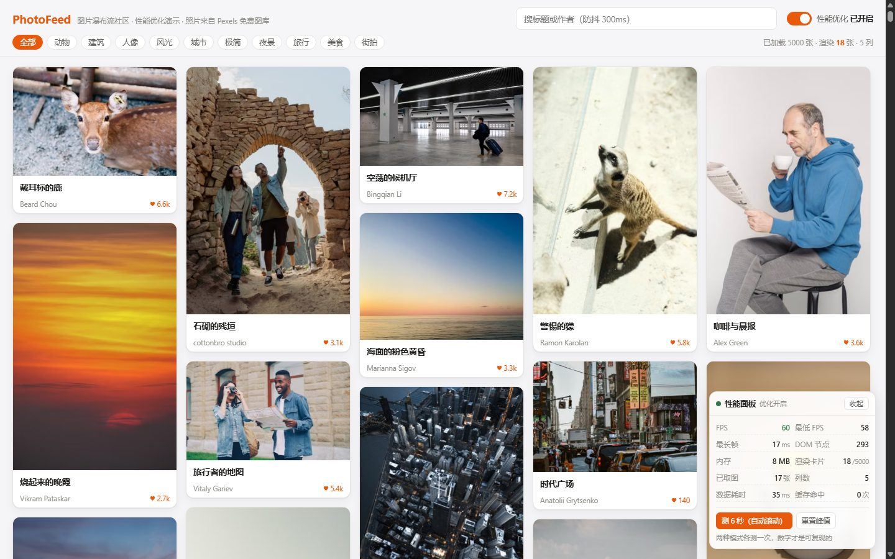

## PhotoFeed · 图片瀑布流社区

5000 条真实照片的信息流，虚拟滚动 + 懒加载保证滚起来不卡，触底自动续接下一批；页面内自带性能面板，「关闭优化」开关一按就能对比出优化前后的真实数字。

### 项目架构

```
PhotoFeed/
├── data/            # 数据（5000 条信息流 + 280 张图片地址表）
├── docs/            # 文档图片
├── scripts/         # 数据生成 / 一键启动 / 性能测量 / 续接验证
├── server/          # 后端 API（Node 原生 http，零第三方依赖）
└── src/             # 前端页面（Vue 3 组合式 + Vite）
    ├── components/  # 卡片、懒加载图、性能面板、灯箱
    ├── composables/ # 瀑布流布局、数据请求、性能监控
    └── utils/       # 请求封装、防抖、取图统计
```

### 技术栈

| 层级 | 技术 |
|---|---|
| 前端 | Vue 3（`<script setup>` 组合式）+ Vite |
| 后端 | Node 原生 `http`（无 Express 等框架，零第三方运行时依赖） |
| 数据 | 本地 JSON（构建期生成，运行期只读） |
| 图片 | Pexels 免费图库 CDN，浏览器实时加载，仓库内不存图片文件 |

### 功能特性

#### 信息流

- 瀑布流布局：按「当前最矮的列」插入，保证 1 2 3 从左到右推进，整体列高均衡

- 虚拟滚动：5000 条数据只渲染可视区内的卡片，页面 DOM 节点从 5.5 万降到 380 左右

- 触底续接：滚动到距底部 1200px 时按 `cursor` 取下一批 500 条并追加

- 增量布局：续接时只计算新增条目的位置，已显示的卡片不做任何重排

#### 筛选与搜索

- 10 个标签分类筛选（风光 / 旅行 / 人像 / 美食 / 夜景 / 极简 / 街拍 / 动物 / 建筑 / 城市）

- 关键词搜索，匹配标题与作者，300ms 防抖

- 结果缓存：相同的「标签 + 关键词」第二次直接取内存，不发请求

- 过期响应丢弃：靠自增序号，先发后到的请求不会覆盖新结果

#### 图片加载

- `IntersectionObserver` 懒加载，全局共享一个观察者实例，提前 300px 开始加载

- LQIP 模糊占位：先取同一张照片的 24×32 模糊版（约 1.2KB），大图到位后淡入替换

- CDN 参数锁比例（`w` / `h` / `fit=crop`），服务端裁好再返回，不产生布局抖动

- 加载失败可点击重试，不会留下一片空白

#### 性能面板

- 实时显示 FPS、最低 FPS、最长帧、DOM 节点数、内存、已取图数、渲染卡片数、列数

- 一键自动测量：每帧固定滚动，滚 6 秒采样，两种模式条件完全一致

- 「关闭优化」开关与 `?opt=0` 参数，随时切换到朴素渲染做对照

#### 灯箱

- 点击卡片查看大图，`←` `→` 翻页，`ESC` 关闭

- 打开时锁定页面滚动、补齐滚动条宽度，焦点在弹层内循环

### 后端 API 文档

#### 元信息模块

| 接口 | 方法 | 说明 |
|---|---|---|
| `/api/meta` | GET | 标签列表、总条数、图片张数、图片地址表（280 条） |

#### 信息流模块

| 接口 | 方法 | 说明 |
|---|---|---|
| `/api/photos` | GET | 按 `keyword` / `tag` 过滤；可选 `page` + `pageSize` 分页，不传则返回全量 |

#### 续接模块

| 接口 | 方法 | 说明 |
|---|---|---|
| `/api/more` | GET | 按 `cursor`（已加载条数）+ `count` 续接下一批；无搜索词时 `hasMore` 恒为 `true` |

#### 系统模块

| 接口 | 方法 | 说明 |
|---|---|---|
| `/api/health` | GET | 健康检查，返回当前进程 pid |

> 统一响应格式：`{ code, msg, data }`，`code` 为 0 表示成功。
> `/api/more` 的 `count` 取值范围 1~2000，默认 500；带 `keyword` 时直接返回空列表并置 `hasMore: false`（搜索结果是有底集合）。

### 性能优化实测

同一份数据、同一个 1440×900 窗口下测得，两列可逐项对照。

| 指标 | 优化关闭 | 优化开启 |
|---|---|---|
| 渲染的卡片数 | 5000 | 17 ~ 40（随视口） |
| 页面 DOM 节点 | 55096 | 约 380 |
| 浏览器内部节点 | 95235 | 约 1000 |
| JS 堆内存 | 约 105 MB | 约 6 MB |
| 加载阶段累计布局耗时 | 约 7.1 s | 0.09 s |
| 首屏图片请求数 | 约 9977 | 约 125 |
| 平均 FPS | 60 | 60 |
| 滚动条高度 | 394893 px | 394893 px |

> 平滑度两边都是 60 帧（走合成层，不参与主线程），真正的差距在节点数、内存和布局耗时这几个量级上。
> 复跑：`node scripts/measure-perf.mjs http://localhost:5175/`，对照态把地址换成 `?opt=0`。

### 本地部署

1. 安装依赖：`npm install`
2. 生成数据：`npm run gen`（`data/photos.json` 已随仓库提供，跳过也能跑）
3. 同时启动前后端：`npm run dev`（前端 5175、后端 3003，会自动做端口占用检查）
4. 浏览器打开 `http://localhost:5175`
5. 生产模式：`npm run build` 后 `npm start`，由 3003 单端口同时托管页面与接口

> 图片来自 Pexels CDN，**首次打开需要联网**；没加载完时看到模糊占位层属于设计如此。

### 图片社区预览图


